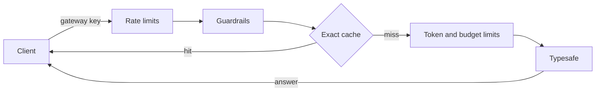

# Decision Models

This page covers how to configure, call and govern **decision models** through the Radicalbit AI Gateway.

## Overview

A **decision model** does not write text. It answers structured questions about a piece of input, such as "what does this customer want?", "is this urgent?" or "how frustrated are they?". It returns a typed answer with a confidence score. Decision models are fast and cheap, so they fit classification, triage and routing steps inside agents and workflows. Calling a full LLM for these steps is slower and more expensive.

The first supported decision model is **Jev** by [Typesafe](https://docs.typesafe.ai). The gateway acts as a proxy for Typesafe's API. Your application sends Typesafe's own request format to the gateway and gets Typesafe's response back unchanged. Along the way, the gateway applies the controls you already use for chat models:

| Capability | Description |
|------------|-------------|
| Proxy | `POST /v1/systemone`, the same path and contract as Typesafe's own API |
| Credential isolation | Clients use a gateway key. The Typesafe API key stays in the gateway configuration |
| Guardrails | Route input guardrails screen and redact the `state` before it leaves the gateway |
| Limits and cost | Rate, input-token and budget limits apply. Cost is tracked on input tokens |
| Caching | Exact caching serves repeated requests with no Typesafe call and no cost |
| Retries and fallback | Transient failures are retried, then the next decision model is tried |
| Tracing | Every call shows in Tracing as a **Decision model** request |

---

## Configuration

Declare decision models at the top level under `decision_models`. Then reference them from a route.

```yaml
decision_models:
  - model_id: jev
    model: typesafe/jev-latest
    credentials:
      api_key: !secret TYPESAFE_API_KEY

routes:
  triage:
    decision_models:
      - jev
```

### Model Fields

| Field | Required | Default | Description |
|-------|----------|---------|-------------|
| `model_id` | Yes | – | Unique identifier, used by routes and fallbacks. It must be unique across all model categories (chat, embedding, transcription, decision) |
| `model` | Yes | – | Must be `typesafe/<model>`, for example `typesafe/jev-latest`, `typesafe/jev-1.13.0` or `typesafe/jev-preview` |
| `credentials.api_key` | No | – | Your Typesafe API key. Store it with `!secret` |
| `credentials.base_url` | No | `https://api.typesafe.ai` | Typesafe endpoint. Do **not** include `/v1`, because the gateway adds `/v1/systemone` itself |
| `retry_attempts` | No | `3` | Retries on transient failures before falling back (minimum `0`) |
| `input_cost_per_million_tokens` | No | `0.042` for Jev | Overrides the default input price. The default applies to `jev-latest`, `jev-1.13.0` and `jev-preview`. Set it explicitly for any other model name |

:::info
Decision models produce no billable output. Any `output_cost_per_million_tokens` you set is ignored and treated as `0`.
:::

### Route Rules

- The **first** model in a route's `decision_models` serves the traffic. Other models in the list are used only as [fallbacks](#errors-retries-and-fallback).
- A route can hold decision models alongside chat, embedding and transcription models.
- [Intelligent routing](./advanced-routing.md) works with chat models only. A `routing` block cannot reference a decision model.
- Every id in a route's `decision_models` must be declared under the top-level `decision_models`. The gateway rejects the configuration at startup otherwise.

### Complete Example

```yaml
cache:
  redis_host: localhost
  redis_port: 6379

decision_models:
  - model_id: jev
    model: typesafe/jev-latest
    retry_attempts: 2
    credentials:
      api_key: !secret TYPESAFE_API_KEY
  - model_id: jev-backup
    model: typesafe/jev-1.13.0
    retry_attempts: 0
    credentials:
      api_key: !secret TYPESAFE_BACKUP_API_KEY

guardrails:
  - name: pii_redaction
    type: presidio_anonymizer
    where: input
    parameters:
      language: en
      entities: ["PERSON", "EMAIL_ADDRESS", "PHONE_NUMBER"]

routes:
  triage:
    decision_models:
      - jev
      - jev-backup
    fallback:
      - target: jev
        fallbacks:
          - jev-backup
        type: decision
    guardrails:
      - pii_redaction
    rate_limiting:
      max_requests: 100
      window_size: 1 minute
    token_limiting:
      input:
        max_tokens: 50000
        window_size: 1 minute
    budget_limiting:
      max_budget: 5
      window_size: 1 day
    caching:
      type: exact
      ttl: 600
```

---

## Calling a Decision Model

**Endpoint:** `POST /v1/systemone`

The request body is Typesafe's own format, with one difference: `model` is your gateway route in `project-name/route-name` format. Authenticate with a gateway API key, the same way as for chat completions.

```bash
curl http://localhost:9000/v1/systemone \
  -H "Authorization: Bearer <YOUR_GATEWAY_KEY>" \
  -H "Content-Type: application/json" \
  -d '{
    "model": "project-name/triage",
    "state": "My card was charged twice and I need the money back today!",
    "questions": {
      "intent": {
        "type": "choice",
        "instructions": "What does the customer want?",
        "criteria": {
          "refund": "Wants money back",
          "information": "Wants an explanation",
          "complaint": "Wants to complain"
        }
      },
      "is_urgent": {
        "type": "noul",
        "instructions": "Does this convey urgency?",
        "criteria": {
          "true": "Explicitly time-sensitive",
          "false": "No urgency expressed"
        }
      },
      "frustration": {
        "type": "score",
        "instructions": "How frustrated is the customer?",
        "criteria": [
          "Calm, neutral tone",
          "Mildly annoyed",
          "Clearly frustrated",
          "Angry or threatening to leave"
        ]
      }
    }
  }'
```

The gateway swaps `model` for the configured upstream model (for example `jev-latest`). It forwards `state`, `questions` and any other field unchanged. Typesafe validates the request. Its status code and body come back to you as they are:

```json
{
  "model": "jev-1.13.0",
  "answers": {
    "intent": {
      "type": "choice",
      "choice": "refund",
      "confidence": 1.0,
      "probabilities": { "refund": 1.0, "information": 0.0, "complaint": 0.0 }
    }
  },
  "usage": { "input_tokens": 337, "output_tokens": 31 }
}
```

See the [API Reference](../api-reference/endpoints.md#decision-models) for every request field, the question types and the error codes. [Typesafe's documentation](https://docs.typesafe.ai) has the full question and answer format.

### Using an Existing Typesafe Client

The endpoint mirrors Typesafe's API, so any Typesafe client or SDK can go through the gateway with three changes:

1. Set the **base URL** to your gateway (for example `http://localhost:9000`).
2. Use a **gateway API key** instead of your Typesafe key.
3. Set **`model`** to your route, `project-name/route-name`.

:::warning No streaming
Decision models do not support streaming. The gateway always returns the complete response in one piece.
:::

---

## Data Flow and Tracing



**What is sent to Typesafe:**

- The request body, with `model` replaced by the upstream model name and `state` redacted by your guardrails (if any are configured).
- Your configured Typesafe API key. The client's gateway key is never forwarded.

**What is recorded in traces:** each call appears in Tracing as a **Decision model** request. The trace contains:

- the `state` (after redaction) and the `questions`;
- the requested model and the model that actually answered;
- whether a fallback was triggered;
- the answers and token usage.

A request served from the cache does not call Typesafe. Its trace records the cache hit and the saved tokens, but not the `state`, `questions` or answers.

:::warning
Traces hold the full content of `state` and `questions`. If your `state` may contain personal data, configure redaction guardrails on the route so that only redacted text is sent to Typesafe and stored in traces.
:::

---

## Guardrails

Only the route's **input** guardrails apply to decision requests. Decision models return no text, so there is nothing to check on output.

- **What is checked:** every text value inside `state`, whether `state` is a string, an object or a list. Keys, numbers, booleans and nulls are not checked.
- **What is not checked:** `questions` are never screened.
- **Redaction** rewrites text values in place and keeps the shape of `state`. For example, `"I am John Smith, write to john@acme.com"` becomes `"I am <PERSON>, write to <EMAIL_ADDRESS>"`.

| Behavior | Result |
|----------|--------|
| `block` | `400`, Typesafe is not called |
| `soft_block` | `400`, Typesafe is not called |
| `warn` | The request goes through and a warning event is recorded |

:::info Soft block returns 400
For chat models, a soft block returns a polite assistant message with status 200. A decision model response has no place for a message, so a soft block on a decision request returns **400**, the same as a block. The guardrail is still recorded as a soft block.
:::

Example error body:

```json
{
  "error": {
    "message": "Sorry, I cannot help with that topic.",
    "type": "guardrail_error",
    "param": {
      "name": "soft_block_secret_project",
      "type": "CONTAINS",
      "where": "INPUT",
      "behavior": "SOFT_BLOCK",
      "parameters": { "type": "CHECK", "values": ["project-zeus"], "ignore_case": false }
    },
    "code": "guardrail_violation_bad_request"
  }
}
```

See [Guardrails](./guardrails.md) for how to define guardrails.

---

## Limits and Cost

### Cost

Typesafe bills **input tokens only**, and output is free. The gateway applies the same model:

- **Cost** = input tokens reported by Typesafe × the input price of the model that answered.
- The default Jev price is **$0.042 per million input tokens**, matching [Typesafe's official pricing](https://docs.typesafe.ai/models). It applies to `jev-latest`, `jev-1.13.0` and `jev-preview`. Override it with `input_cost_per_million_tokens`.
- If a model has no price, its cost is recorded as zero and it does not count toward budgets. Set `input_cost_per_million_tokens` for any other Typesafe model name.
- Output tokens are always recorded at zero cost.

:::tip
The input tokens Typesafe reports include its own processing of your questions. Expect roughly **260 tokens of overhead** per request on top of the size of your `state` and question text. Take this into account when you size input-token limits and budgets.
:::

### Limits

The route's existing limits apply to decision traffic, and decision spend counts toward every budget:

| Limit | Applies | Notes |
|-------|---------|-------|
| [Rate limiting](./rate-limiting.md) | Yes | Each call counts as one request. This includes cache hits and requests blocked by guardrails |
| [Token limiting](./token-limiting.md) — `input` | Yes | Counted from the tokens Typesafe reports |
| [Token limiting](./token-limiting.md) — `output` | No | Rejected at startup on routes that hold only decision models |
| [Budget limiting](./budget-limiting.md) | Yes | Route, key and project budgets |

Rate limits are checked first, before guardrails. Token and budget limits are checked after the cache lookup. The gateway does not know how many tokens a request will use until Typesafe answers, so these limits block a request only when the counter is **already** full, never on an estimate. A blocked request returns `429` and never reaches Typesafe. Failed upstream calls consume nothing.

---

## Caching

Decision models support **exact caching** only.

```yaml
routes:
  triage:
    decision_models:
      - jev
    caching:
      type: exact
      ttl: 600   # seconds
```

- Two requests match when they have the same `state` (after redaction), the same `questions`, the same project, route and API key, and the same primary decision model. Key order in the JSON does not matter. Other top-level fields are not part of the match.
- Only successful responses are stored.
- A cache hit returns the stored response with **no Typesafe call and no cost**. It does not consume token or budget limits, but it does count toward the rate limit.
- **Semantic caching** is rejected on routes that hold only decision models. On mixed routes, decision requests skip the semantic cache entirely.

Redis and in-memory cache backends both work. See [Caching](./caching.md) for backend setup.

---

## Errors, Retries and Fallback

| Typesafe outcome | Retried | Fallback | Client receives |
|------------------|---------|----------|-----------------|
| Success (2xx) | – | – | Typesafe's response |
| Client error (4xx other than 429) | No | No | Typesafe's status and body, unchanged |
| `429`, `5xx`, network error or timeout | Yes, up to `retry_attempts` | Yes | The first successful answer in the chain |
| Every model failed with a response | – | – | The last status and body from Typesafe |
| Every model failed with no response | – | – | `502` |

Retries use a short exponential backoff. On a `429`, the gateway respects Typesafe's `Retry-After` header.

To fall back to another decision model, list it on the route and add a fallback with `type: decision`, as in the [complete example](#complete-example). A decision fallback may only name decision models listed on the same route. Mixing with chat or other categories is rejected at startup.

Example `502` body when no model answered:

```json
{
  "error": {
    "message": "No decision model answered for route triage",
    "type": "model_invoker_error",
    "param": null,
    "code": "model_invoker_bad_gateway"
  }
}
```

Gateway-side errors:

| Status | Cause |
|--------|-------|
| `400` | Unknown route, a route with no decision models, or a guardrail block or soft block |
| `401` | Missing, invalid or [expired](../credentials.md#expiration) gateway key, or a key that does not belong to the route |
| `422` | The request body is invalid, for example `model` is missing |
| `429` | A rate, token or budget limit is full |
| `502` | No decision model answered |

---

## Best Practices

- **Keep secrets in `!secret`**: never put the Typesafe API key in plain YAML.
- **Redact before sending**: add PII redaction guardrails to routes whose `state` carries user data. Redaction protects both what reaches Typesafe and what is stored in traces.
- **Enable exact caching** for repeated classifications, such as fixed labels or recurring tickets.
- **Add a fallback** decision model for production routes. Set `retry_attempts: 0` on the last model in the chain if you prefer to fail fast.

---

## Troubleshooting

### Common Issues

1. **`provider ... is not supported`**: decision models must use `model: typesafe/<model>`.
2. **Typesafe returns "not found" on a custom endpoint**: remove `/v1` from `credentials.base_url`. The gateway adds `/v1/systemone` itself.
3. **`Route ... has no decision models defined`**: add `decision_models` to the route named in `model`.
4. **`token_limiting.output is not allowed`**: remove the `output` limit from routes that hold only decision models.
5. **`semantic caching is not allowed`**: use `type: exact` on routes that hold only decision models.
6. **Unexpected 400 with `guardrail_error`**: an input guardrail matched the `state`. A soft block also returns 400 for decision models.

---

## Next Steps

- **[Guardrails](./guardrails.md)** — Define the input checks and redaction applied to `state`
- **[Fallback](./fallback.md)** — Configure failover between models
- **[Budget Limiting](./budget-limiting.md)** — Cap decision spend per route, key or project
- **[API Reference](../api-reference/endpoints.md#decision-models)** — Request, response and error reference for `POST /v1/systemone`
- **[Model Configuration](../configuration/models.md)** — All model categories and fields
