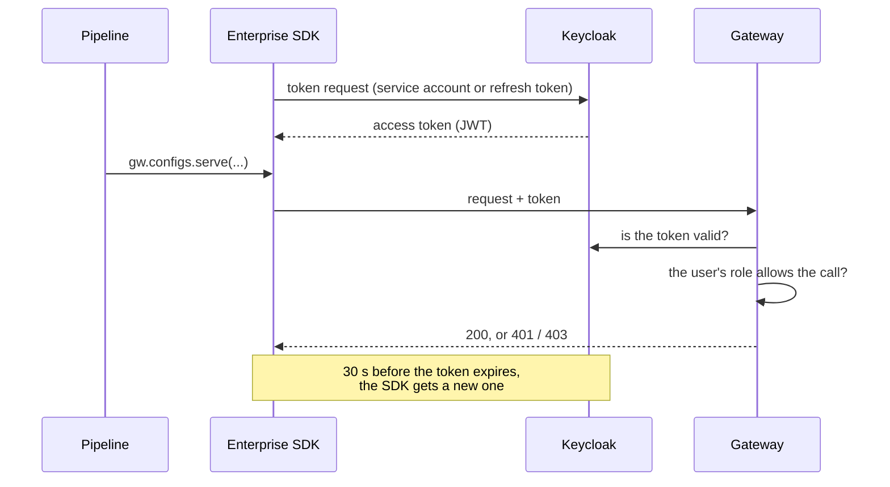

# Enterprise: Signing In

:::info[Enterprise Feature]{className="enterprise-badge"}
This feature is available exclusively in the **Enterprise edition** of the Radicalbit AI Gateway, with the [Keycloak IDP plugin](../access-control/keycloak-idp.md).
:::

With [Access Control](../access-control/index.md) enabled, every call to the management API must come from someone the gateway knows, with a role that allows it. The Enterprise package, `radicalbit-ai-gateway-enterprise-sdk`, is the [Python SDK](./index.md) with Keycloak sign-in built in and the [Enterprise operations](#enterprise-operations): the methods, models, errors and options of the SDK are the same.

```python
from radicalbit_gateway_enterprise import Gateway, errors

with Gateway() as gw:  # gateway, Keycloak and credentials from the environment
    project = gw.projects.create(name='payments')
    slot_a = project.configs[0]
    gw.configs.save(project.uuid, slot_a.uuid, config_file=config)
    gw.configs.approve(project.uuid, slot_a.uuid)
    gw.configs.serve(project.uuid, slot_a.uuid)
```

The pipeline contains no authentication code: the client gets a token from Keycloak, sends it with every call, and renews it before it expires.

---

## How It Works



The gateway checks two things on every call:

1. **Who is calling.** The token must be valid in Keycloak, and belong to a user the gateway has synced.
2. **What their role allows.** The user's role (ADMIN, BUILDER or AUDITOR) must allow the operation, and a BUILDER or AUDITOR must be a member of the project. See [what each role can do](#what-each-role-can-do).

---

## A Pipeline: Service Account

A pipeline signs in as a **service account**: a Keycloak client of its own, with no person behind it and no password to rotate by hand.

### Setting it up

1. **In Keycloak**, create a client for the pipeline (e.g. `ci-pipeline`) with **Client authentication** on and **Service accounts roles** enabled. Note its client secret.
2. **In Keycloak**, add the client's service-account user (`service-account-ci-pipeline`) to one of the gateway's RBAC groups (`KEYCLOAK_IDP_RBAC_GROUPS`). In an admin group (`KEYCLOAK_IDP_RBAC_ADMIN_GROUPS`) it becomes an ADMIN at once.
3. **Wait for the user sync** (`KEYCLOAK_IDP_RBAC_CRON`, every 5 minutes by default). The service account then appears on the **Users** page, marked as a service account.
4. **In the gateway**, an ADMIN gives it a role on the **Users** page and, for a BUILDER, adds it to the projects it works on — as for a person.

Give the pipeline the smallest role that does the job: a pipeline that only prepares configurations for review is a BUILDER; one that also publishes them must be an ADMIN.

### Configuring the pipeline

| Environment variable | Description |
|---|---|
| `RADICALBIT_GATEWAY_BASE_URL` | The gateway, e.g. `https://gateway.example.com` |
| `RADICALBIT_GATEWAY_KEYCLOAK_URL` | Keycloak, e.g. `https://sso.example.com` |
| `RADICALBIT_GATEWAY_KEYCLOAK_REALM` | The gateway's realm |
| `RADICALBIT_GATEWAY_CLIENT_ID` | The service account's client, e.g. `ci-pipeline` |
| `RADICALBIT_GATEWAY_CLIENT_SECRET` | Its client secret |

Keep the client secret in your CI's secret store, never in the repository.

```python
from radicalbit_gateway_enterprise import Gateway

with Gateway() as gw:
    print([p.name for p in gw.projects.list()])
```

### In code

To pass the values explicitly instead:

```python
from radicalbit_gateway_enterprise import Gateway, KeycloakAuth

auth = KeycloakAuth.service_account(
    'ci-pipeline',
    client_secret,
    keycloak_url='https://sso.example.com',
    realm='acme',
)
with Gateway('https://gateway.example.com', auth=auth) as gw:
    ...
```

### Calling the AI routes too

A service account can also call the gateway's AI endpoints (chat completions, responses, embeddings) with its Keycloak token, like a person can with [token-based authentication](../access-control/keycloak-idp.md#token-based-api-authentication). For that, add its service-account user to a group the gateway imports (`KEYCLOAK_IDP_IMPORT_GROUPS`): the next group sync gives it a gateway credential in that group, and the group's routes decide what it can call.

---

## A Person: Token or Refresh Token

For a script run by a person, pass their Keycloak tokens instead of a client secret:

| Environment variable | Description |
|---|---|
| `RADICALBIT_GATEWAY_TOKEN` | An access token (JWT) |
| `RADICALBIT_GATEWAY_REFRESH_TOKEN` | A refresh token: the SDK uses it to get new access tokens |
| `RADICALBIT_GATEWAY_KEYCLOAK_URL`, `RADICALBIT_GATEWAY_KEYCLOAK_REALM`, `RADICALBIT_GATEWAY_CLIENT_ID` | Needed with a refresh token: where to renew it, and the client that issued it |
| `RADICALBIT_GATEWAY_CLIENT_SECRET` | Only if that client is confidential |

With a refresh token, renewal is automatic. An access token alone works until it expires; after that, calls fail with `AuthenticationError` (`code` `token_expired`) without reaching the gateway.

```python
from radicalbit_gateway_enterprise import Gateway, KeycloakAuth

auth = KeycloakAuth.user(
    access_token,
    refresh_token=refresh_token,
    client_id='gateway-scripts',
    keycloak_url='https://sso.example.com',
    realm='acme',
)
```

:::tip
The SDK does not take a username and password. Use a service account for automation, and tokens obtained through your usual Keycloak login for a person. For scripts that renew tokens, a **public** Keycloak client is simpler than the admin interface's own client, which is confidential and would need its secret.
:::

---

## Enterprise Operations

Next to the methods of the [Reference](./reference.md), the Enterprise package manages users, project members and the audit log:

| Method | What it does |
|---|---|
| `gw.users.list(role=, exclude_role=)` | List the users, people and service accounts, optionally by role |
| `gw.users.me()` | The user the SDK is signed in as |
| `gw.users.assign_role(user_uuid, role=)` | Give a user the `BUILDER` or the `AUDITOR` role (an ADMIN's role can't change) |
| `gw.project_members.add(project_uuid, user_uuids=[...])` | Make users members of a project |
| `gw.project_members.remove(project_uuid, user_uuid)` | Remove a member from a project |
| `gw.project_members.list_associable(project_uuid)` | The users that can be added: BUILDERs and AUDITORs that are not members yet |
| `gw.audit_logs.list(page=, size=, entity_type=, action=, actor_uuid=, entity_uuid=, from_=, to=)` | The audit log, newest first, up to 100 entries a page |
| `gw.audit_logs.history(entity_uuid, page=, size=)` | The audit log of one project, credential, group, user or alert rule |

A BUILDER service account can only work on projects it is a member of. An ADMIN pipeline can set that up in the same run:

```python
from radicalbit_gateway_enterprise import Gateway

with Gateway() as gw:  # signed in as an ADMIN service account
    project = gw.projects.create(name='payments')
    builder = next(
        u for u in gw.users.list(role='BUILDER')
        if u.username == 'service-account-ci-builder'
    )
    gw.project_members.add(project.uuid, user_uuids=[builder.uuid])
```

Adding a user who is already a member raises `ConflictError` with `code` `user_already_in_project`.

---

## What Each Role Can Do

| SDK methods | ADMIN | BUILDER | AUDITOR |
|---|:---:|:---:|:---:|
| `projects.list`, `projects.get` | Yes | Member projects | Member projects |
| `projects.create` | Yes | No | No |
| `configs.validate` | Yes | Yes | No |
| `configs.save`, `configs.upload`, `configs.approve`, `configs.cancel_approval` | Yes | Member projects | No |
| `configs.serve`, `configs.unserve` | Yes | No | No |
| `credentials.*`, `groups.*` | Yes | No | No |
| `users.me` | Yes | Yes | Yes |
| `users.list`, `users.assign_role`, `project_members.*` | Yes | No | No |
| `audit_logs.*` | Yes | No | Yes |

---

## Errors

The [SDK errors](./reference.md#errors) apply. Signing in adds these:

| What happened | Exception | `code` |
|---|---|---|
| Keycloak refused the token request (wrong secret, revoked refresh token) | `AuthenticationError` | Keycloak's error, e.g. `unauthorized_client` |
| The access token expired and there is no refresh token | `AuthenticationError` (no status: the gateway was not called) | `token_expired` |
| The gateway received no token | `AuthenticationError` (401) | `not_authenticated` |
| Keycloak rejected the token (expired, revoked) | `AuthenticationError` (401) | `invalid_token` |
| The user has no role in the gateway: not synced yet, no role assigned yet, or removed by the sync | `AuthenticationError` (401) | `user_has_no_role` |
| The role does not allow the operation | `AuthorizationError` (403) | `role_not_allowed` |
| A BUILDER or AUDITOR called into a project they are not a member of | `AuthorizationError` (403) | `not_a_project_member` |

```python
from radicalbit_gateway_enterprise import Gateway, errors

try:
    gw.configs.serve(project.uuid, slot_a.uuid)
except errors.AuthorizationError as error:
    if error.code == 'role_not_allowed':
        print('Only an ADMIN can publish: ask one to serve this configuration.')
        raise
```

A service account just added to an RBAC group answers `user_has_no_role` until the next user sync, and then until an ADMIN gives it a role (members of an admin group are ADMINs as soon as they are synced).

### Credentials owned by Keycloak

Credentials and groups created by the [group and key sync](../access-control/keycloak-idp.md#group-and-key-sync) belong to Keycloak: who is in which group is managed there. Deleting or rotating such a credential, or adding credentials to or removing them from such a group, raises `ConflictError` (409) with `code` `key_externally_managed` or `group_externally_managed`. Change the membership in Keycloak instead; the next sync applies it. Which routes such a group can call is still yours to set, with `groups.add_routes` and `groups.remove_route`.

```python
try:
    gw.credentials.rotate(credential_uuid, grace_period='24 hours')
except errors.ConflictError as error:
    if error.code == 'key_externally_managed':
        print('This credential is managed by Keycloak.')
```

---

## Next Steps

- **[Reference](./reference.md)** — Every method, errors, retries and client options
- **[Examples](./examples.md)** — Pipelines for common tasks
- **[Keycloak IDP Plugin](../access-control/keycloak-idp.md)** — Roles, RBAC groups and syncs
