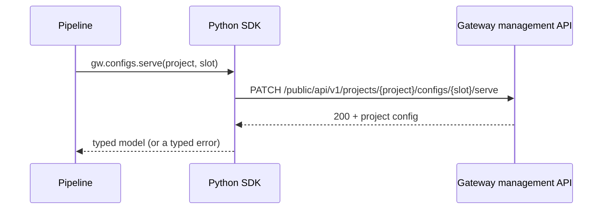
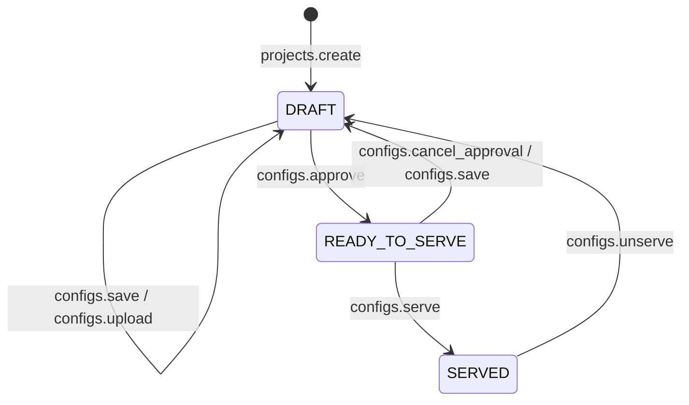

# Python SDK

The Python SDK manages the gateway from code: create projects, credentials and groups, validate a configuration, save it, mark it ready to serve and publish it. It is built for CI/CD pipelines and scripts that need to do what the admin interface does, without a person clicking through it.

Everything the SDK creates is the same object you see in the admin interface: a project created from a pipeline shows up on the **Projects** page, a credential on the **Credentials** page.

---

## Installation

The SDK needs Python 3.11 or later.

```bash
pip install radicalbit-ai-gateway-sdk
```

:::info[Enterprise Feature]{className="enterprise-badge"}
With [Access Control](../access-control/index.md) enabled, use the Enterprise package instead: the same SDK, which also signs in to Keycloak for you. See **[Enterprise: Signing In](./enterprise.md)**.
:::

---

## A First Pipeline

The example below takes a configuration from a file to production, and gives a team a credential that can call its route.

```python
from radicalbit_gateway import Gateway

config = open('config.yaml').read()

with Gateway('https://gateway.example.com') as gw:
    project = gw.projects.create(name='support-bot')
    slot_a = project.configs[0]

    gw.configs.validate(config_file=config)                 # dry run: saves nothing
    gw.configs.save(project.uuid, slot_a.uuid, config_file=config)
    gw.configs.approve(project.uuid, slot_a.uuid)           # READY_TO_SERVE
    gw.configs.serve(project.uuid, slot_a.uuid)             # SERVED: routes are live

    credential = gw.credentials.create(name='support-bot-prod')
    # Save credential.api_key now: no later response returns it

    group = gw.groups.create(name='support')
    gw.groups.add_credentials(group.uuid, keys=[credential.uuid])
    gw.groups.add_routes(group.uuid, project.uuid, routes=['support-route'])
```

The gateway's address can also come from the environment, so the same pipeline runs against every environment:

```bash
export RADICALBIT_GATEWAY_BASE_URL=https://gateway.example.com
```

```python
with Gateway() as gw:
    ...
```

---

## How It Works

The SDK is a thin client of the gateway's management API (`/public/api/v1`), the same API the admin interface uses.



- **One method, one API call.** `gw.configs.serve()` sends exactly one request. The SDK never chains calls behind your back, so what happened on the gateway is always what you called.
- **Typed answers.** Each method returns the API's own response as a Python model with editor completion (`project.configs`, `credential.api_key`).
- **Typed errors.** Every refusal is an exception with the HTTP status, a stable `code` and a readable `message`: a pipeline can tell "already exists" from "not ready to serve" without parsing text. See [Errors](./reference.md#errors).
- **Safe retries.** A call that failed because the gateway was briefly unreachable or overloaded is sent again automatically, but only when sending it twice cannot do the work twice. See [Retries](./reference.md#retries).
- **Sync and async.** `Gateway` for scripts and pipelines, `AsyncGateway` for asyncio applications, with the same methods.

### The configuration lifecycle

The `configs` methods follow the [project lifecycle](../configuration/projects.md#configuration-lifecycle). Every project has two configuration slots, `A` and `B`, in `project.configs`: while one is served, the other can be prepared.



Serving a slot takes the other slot out of service if it was served (it goes back to `DRAFT`): a project serves one configuration at a time, and the switch has no gap.

`configs.validate` checks a configuration against the schema without saving it, so a pipeline can fail fast on a pull request, before anything reaches the gateway. It does not check [secrets](../deployment/secrets-management/index.md): a configuration that validates can still be refused on save or on serve when it references a secret that doesn't exist.

---

## Next Steps

- **[Enterprise: Signing In](./enterprise.md)** — Service accounts and users with Keycloak
- **[Reference](./reference.md)** — Every method, its arguments, errors, retries and client options
- **[Examples](./examples.md)** — Pipelines for common tasks
